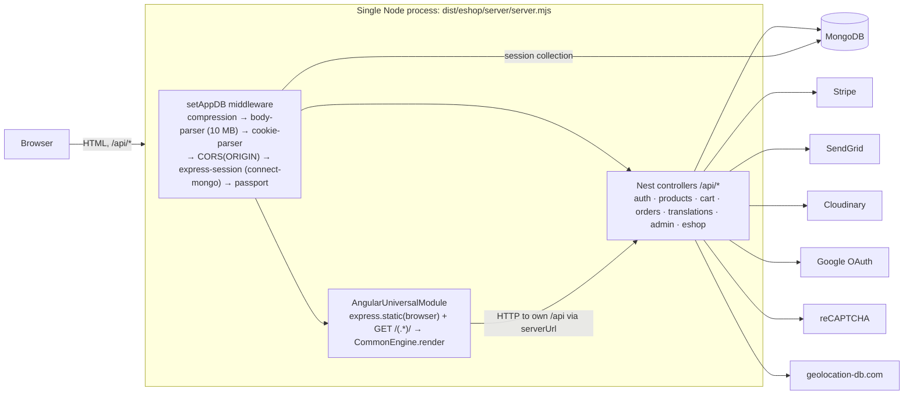
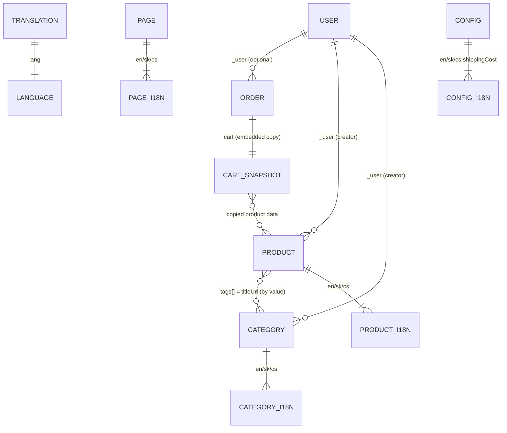

# Architecture

This document describes the state of the `master` branch as of 2026-10-14 (Angular 22.2,
NestJS 12, Mongoose 8.4). Its purpose is twofold:
1. Onboarding.
2. Input for the planned MongoDB → PostgreSQL migration (see [Data model](#data-model)).

Known problems are listed in [audit.md](audit.md); this document describes what *is*,
not what should be.

## 1. Runtime topology

- Production entry:
  1. `angular.json` → `ssr.entry: server-ssr.ts`, which imports
     `server/src/main-ssr.ts`. The whole Nest app is bundled into the Angular server bundle.
  2. `main-ssr.ts` creates `AppSSRModule` (= `AppModule` + `AngularUniversalModule`) and
     listens on `PORT`.
  3. `AngularUniversalModule` registers static file serving and a catch-all GET route
     after the API routes. Unknown `/api/*` GETs therefore fall through to SSR.
- During SSR, Angular calls the API over HTTP. It uses the `serverUrl` provider, built
  from the incoming request's protocol and `Host` header.
- **Development:** `server/src/main.ts` (API only, `:4000`) plus `ng serve` (`:3000`).
- **Docker** (`Dockerfile`):
  1. The build stage (`node:24.21-alpine3.24`) runs `npm install` and then
     `npm run build:ssr`.
  2. The runtime stage copies `package*.json`, `.env*` and `dist`, runs `npm i whatwg-url`,
     and ends with `ENTRYPOINT npm run start`.

## 2. Backend (NestJS)

### Modules

| Module | Responsibility | Models registered | Notes |
|---|---|---|---|
| `AppModule` | Root. `ConfigModule.forRoot({isGlobal})`, `MongooseModule.forRoot(MONGO_URI)` | – | `ServeStaticModule` is commented out |
| `AuthModule` | Signup/signin, JWT, Google OAuth, `RolesGuard` | `User` | Exports `JwtStrategy` and `PassportModule` |
| `ProductsModule` | Products and categories (public + admin CRUD) | `Product`, `Category` | Exports `MongooseModule` |
| `CartModule` | Session cart add/remove/get | (Product via `ProductsModule`) | |
| `OrdersModule` | Cash-on-delivery and Stripe orders, admin order management, order emails | `Order`, `Translation` | |
| `TranslationsModule` | UI translation dictionaries | `Translation` | Controller uses the model directly (no service) |
| `AdminModule` | Image library and Cloudinary upload | (Product via `ProductsModule`) | Class-level JWT + admin guards |
| `EshopModule` | Shop config, themes, CMS pages, contact form | `Page`, `Theme`, `Config`, `Translation` | |
| `AppSSRModule` / `AngularUniversalModule` | SSR rendering + static files | – | Production only |

### Request pipeline

Middleware: `setAppDB.ts`. There is no global prefix, no global `ValidationPipe`, no helmet
and no rate limiting.

**Auth**
- `Authorization: Bearer <jwt>` is checked by `JwtStrategy`.
- The payload is `{ email }`. The strategy loads the user by email on every request.
- `RolesGuard` requires `'admin'` in `user.roles`.

**Language**
- Most endpoints read the `lang` request header (`en` | `sk` | `cs`).
- Products and pages project or sort on `<lang>.*` fields.

**Session** (express-session + connect-mongo, collection `session`, 30-day cookie) holds:
- `session.cart = { items: [{ id, qty, item: <full Product document snapshot> }] }`;
- `session.config`: a copy of the active `Config` document, set by `GET /api/eshop/config`;
- `session.images`: the admin's image library.

### Endpoints

Guard legend:
- `–` public;
- `JWT` logged in;
- `ADMIN` JWT + `RolesGuard`.

"Pipe" means a `ValidationPipe` actually runs on that endpoint.

| Method | Path | Guard | Pipe | Purpose |
|---|---|---|---|---|
| GET | `/api/auth` | JWT | – | Current user `{id, email, roles}` |
| POST | `/api/auth/signup` | – | yes (no whitelist) | Create user (email, password) |
| POST | `/api/auth/signin` | – | yes | Returns `{accessToken, id, roles, email}` |
| GET | `/api/auth/google` | google | – | Start OAuth |
| GET | `/api/auth/google/callback` | google | – | Redirect to `${ORIGIN}/jwtToken/<jwt>` |
| GET | `/api/products` | – | yes | Paginated list. Query `page, sort, category?, search?, maxPrice?`; header `lang` |
| GET | `/api/products/categories` | – | – | Visible categories for `lang` |
| GET | `/api/products/search?query=` | – | – | Title search (regex) |
| GET | `/api/products/all` | ADMIN | – | All products |
| GET | `/api/products/:name` | – | – | Product by `titleUrl` (`?lang=` → localized shape) |
| DELETE | `/api/products/:name` | ADMIN | – | Delete product |
| POST | `/api/products/add` | ADMIN | – | Create product (creates categories from tags) |
| PATCH | `/api/products/edit` | ADMIN | – | Upsert product by `titleUrl` |
| GET | `/api/products/categories/all` | ADMIN | – | All categories |
| PATCH | `/api/products/categories/edit` | ADMIN | – | Upsert category |
| DELETE | `/api/products/categories/:name` | ADMIN | – | Delete category and pull it from product tags |
| GET | `/api/cart` | – | – | Localized cart with totals |
| GET | `/api/cart/add?id=` | – | yes | Add product to session cart |
| GET | `/api/cart/remove?id=` | – | yes | Remove one unit |
| GET | `/api/orders` | JWT | – | Current user's orders |
| POST | `/api/orders/add` | – | – | Cash-on-delivery order from session cart + emails |
| POST | `/api/orders/stripe` | – | – | Stripe charge (token) + capture + order + emails |
| GET | `/api/orders/all` | ADMIN | – | All orders |
| GET | `/api/orders/:id` | ADMIN | – | Order by `orderId` |
| PATCH | `/api/orders` | ADMIN | – | Update order (e.g. status) |
| GET | `/api/translations?lang=` | – | – | Translation dictionary. Without `lang`, guessed by geolocation. |
| GET | `/api/translations/all` | ADMIN | – | All dictionaries |
| PATCH | `/api/translations/all` | ADMIN | – | Bulk upsert dictionaries |
| PATCH | `/api/translations?lang=` | ADMIN | – | Update one dictionary |
| GET | `/api/admin/images` | ADMIN | – | Session image library |
| POST | `/api/admin/images/add` | ADMIN | – | Add image URL to product or library |
| POST | `/api/admin/images/upload` | ADMIN | – | Multipart upload → Cloudinary |
| POST | `/api/admin/images/remove` | ADMIN | – | Remove image from product or library |
| GET | `/api/eshop/config` | – | – | Base64 JSON of `FE_*` env + active theme styles. Stores the active config in the session. |
| POST | `/api/eshop/contact` | – | – | Contact form (reCAPTCHA) → emails |
| GET | `/api/eshop/page/all?titles=` | – | – | CMS pages |
| POST | `/api/eshop/page` | ADMIN | – | Upsert page |
| GET | `/api/eshop/page/:titleUrl` | – | – | Page by slug (header `lang`) |
| DELETE | `/api/eshop/page/:titleUrl` | ADMIN | – | Delete page |
| GET | `/api/eshop/theme/all` | – | – | All themes |
| POST | `/api/eshop/theme` | ADMIN | – | Upsert theme |
| DELETE | `/api/eshop/theme/:titleUrl` | ADMIN | – | Delete theme |
| GET | `/api/eshop/config/all` | – | – | All shop configs |
| POST | `/api/eshop/config` | ADMIN | – | Upsert config |
| DELETE | `/api/eshop/config/:titleUrl` | ADMIN | – | Delete config |

## 3. Frontend (Angular)

**Bootstrap**
- `client/src/main.ts` bootstraps with `appConfig`: zoneless change detection, router,
  `HttpClient` with fetch, and client hydration with HTTP transfer cache.
- Two app initializers run first:
  1. load translations (`TranslateService.use`);
  2. load the runtime config (`EnvConfigurationService.load` → `GET /api/eshop/config`).
- `app.config.server.ts` adds `provideServerRendering()`.

**Routing** (`app.routes.ts`): routes are generated for each language prefix.

| Path | Loads | Guard |
|---|---|---|
| `/` | `HomeComponent` | – |
| `/404` | `NotFoundComponent` | – |
| `/:lang/product/{all, category/:category, :id}` | `ProductModule` (lazy) | – |
| `/:lang/cart` and `/:lang/cart/summary` | `CartModule` (lazy, checkout) | – |
| `/:lang/orders` and `/:lang/orders/:id` | `OrderModule` (lazy) | `AuthGuard` |
| `/:lang/dashboard`, `…/orders`, `…/orders/:id`, `…/translations` | `DashboardModule` (lazy) | `AdminGuard` |
| `/:lang/eshop/{contact, :titleUrl}` | standalone eshop components | – |
| `/:lang/authorize/{signin, signup}` | standalone auth components | – |
| `/jwtToken/:accessToken` | Google OAuth landing | – |
| `**` | redirects to `/404` | – |

The admin sections (products, categories, pages, theme, config) are tabs inside the
dashboard component, not routes.

**State**
- A custom signal store with no NgRx:
  - `store/signal.store.selectors.ts` holds the signal slices `userState`, `eshopState`,
    `productState` and `dashboardState`, plus `computed` selectors;
  - `store/signal.store.ts` holds the "actions". Each action calls `ApiService`,
    subscribes, and updates the signals.
- Components usually consume the store through `toObservable(...)` and `| async`.

**HTTP**
- `services/api.service.ts` builds every request. It sends `Authorization: Bearer <token>`
  (token from `localStorage`) and the `lang` header, with `withCredentials: true` so the
  session cookie is included.
- Base URL:
  - dev: `http://localhost:4000`;
  - production SSR: `serverUrl`;
  - production browser: `window.location.origin`.

**i18n**
- Runtime dictionaries come from `GET /api/translations` and are rendered with the
  `translate` pipe (`{{ 'Key' | translate | async }}`).
- The active language is stored in the `eshop_lang` cookie.
- Prices and currency per language: `en`/`sk` → EUR, `cs` → CZK (`shared/constants.ts`).

**Theming**
- The active `Theme.styles` arrive base64-encoded from `/api/eshop/config`.
- `EnvConfigurationService` + `ThemeService` apply them as CSS custom properties, in the
  browser only.
- The base look comes from the Material M2 theme (`client/src/styles`).

## 4. Main data flows

**Browse**
1. `GET /api/products?page&sort&category&maxPrice` with the `lang` header.
2. `paginate` (`server/src/shared/utils/paginate.ts`) runs a sorted, skipped and limited
   find (12 per page), plus a count and the min/max `salePrice`.
3. The response is `{ all, pagination, maxPrice, minPrice }`.

**Cart**
- `GET /api/cart/add?id=` loads the product and pushes a full snapshot into
  `session.cart` (`server/src/cart/utils/cart.ts`).
- `prepareCart(cart, lang, session.config)` (`server/src/shared/utils/prepareUtils.ts`)
  builds the localized cart:
  - it drops items that are invisible or have no price;
  - `totalPrice = Σ salePrice × qty`;
  - shipping is `extended` if any item has `shipping: 'extended'`, otherwise `basic`;
  - shipping cost comes from `session.config[lang].shippingCost[type]`, falling back to
    the hardcoded defaults in `server/src/shared/constans.ts`;
  - shipping is free when the total ≥ `limit`;
  - the returned `totalPrice` **includes** shipping.

**Checkout**
- The client runs a 3-step Material stepper: address, then payment method (card or cash
  on delivery), then summary.
- **Cash on delivery:** `POST /api/orders/add`
  1. builds an `Order` from the session cart (`status: NEW`, `type: PAYMENT_ON_DELIVERY`);
  2. emails the customer and every `ADMIN_EMAILS` address via SendGrid.
- **Card:**
  1. Stripe.js v3 Elements `createToken(card)` runs in the browser.
  2. `POST /api/orders/stripe {token, currency, email, addresses, notes, userId?}` follows.
  3. The server calls `stripe.charges.create({amount: total*100, currency, source: token.id,
     capture:false})` and then `charges.capture`.
  4. It saves the order (`status: PAID`, `cardId`) and sends the emails.
  5. This uses the legacy Charges API: no PaymentIntents, no webhooks.

**Auth**
- Email/password: `POST /api/auth/signin` returns `{accessToken, …}`. The token is stored
  in `localStorage` and sent as a Bearer header.
- Google:
  1. `/api/auth/google`
  2. Google
  3. `/api/auth/google/callback`, which finds or creates the user by email and redirects
     to `/jwtToken/<jwt>`.
  4. The client stores the token there.
- Admin: users with `'admin'` in `roles`. There is no UI to grant it; it is set in the
  database.

**Admin**
- Products, categories, pages, themes, configs and translations are created and updated
  through upsert endpoints keyed by `titleUrl` (or `lang`).
- Images are uploaded via multer memory storage → Cloudinary `upload_stream`. The URL is
  stored in `Product.images` or `session.images`.
- Rich text (product descriptions, pages) is edited with TinyMCE (`FE_TINYMCE_API_KEY`).

## 5. Data model

All schemas are plain Mongoose `new Schema({...})` definitions in
`server/src/<feature>/schemas/`. Common traits, important for migration:

- **No field is `required`.** There are **no indexes** (besides `_id`), **no unique
  constraints**, **no timestamps** (`dateAdded` is set by hand), and **no enums**.
- **i18n by embedding:** Product, Category, Page and Config have one sub-document per
  language under the keys `en`, `sk`, `cs`. These keys are generated from
  `languages` in `server/src/shared/constans.ts`, so adding a language changes the
  schema shape.
- **Slugs as keys:**
  - `titleUrl` is the de-facto natural key for Product, Category, Page, Theme and Config
    (all lookups and upserts use it) but is not unique-indexed;
  - `Order.orderId` and `Translation.lang` play the same role.
- **ObjectId refs** use `ref: 'user'`, but the model is registered as `'User'`. No code
  calls `populate()`.
- Collection names follow Mongoose pluralization: `users`, `products`, `categories`,
  `orders`, `translations`, `pages`, `themes`, `configs`. Sessions are in `session`
  (connect-mongo).

### User (`server/src/auth/schemas/user.schema.ts`)
| Field | Type | Notes |
|---|---|---|
| `email` | String | Login identifier, looked up on every JWT request. Not unique-indexed. |
| `password` | String | bcrypt hash |
| `salt` | String | bcrypt salt (redundant; bcrypt embeds it) |
| `googleId` | String | Set for Google sign-ups |
| `name` | String | |
| `roles` | Array (untyped) | `'admin'` grants admin |
| `cart` | Mixed, default `{items: []}` | **Unused** (the cart lives in the session) |
| `images` | Array | **Unused** (the image library lives in the session) |

### Product (`server/src/products/schemas/product.schema.ts`)
| Field | Type | Notes |
|---|---|---|
| `titleUrl` | String | Slug / natural key |
| `mainImage` | `{ url: String, name: String }` | Cloudinary URL |
| `images` | Array of String (URLs) | |
| `tags` | Array of String | Category `titleUrl`s (loose link to Category) |
| `_user` | ObjectId → User | Creator (admin) |
| `dateAdded` | Date | Sort key for "newest" / "oldest" |
| `en` / `sk` / `cs` | sub-document, see below | One per language |

Per-language sub-document:

| Field | Type | Notes |
|---|---|---|
| `title` | String | |
| `description` | String | |
| `descriptionFull` | Array | HTML strings (TinyMCE) |
| `regularPrice` | Number | Decimal major units; not used in pricing |
| `salePrice` | Number | Decimal major units; **the** price |
| `onSale` | Boolean | Display only |
| `stock` | **String** | Display only; never checked or decremented |
| `visibility` | Boolean | Hidden products are excluded from lists and the cart |
| `shipping` | String | `'basic'` / `'extended'` |

Plugin: `paginate.pagination` (custom static `paginate()`).

### Category (`server/src/products/schemas/category.schema.ts`)
| Field | Type | Notes |
|---|---|---|
| `titleUrl` | String | Matches `Product.tags[]` entries |
| `mainImage` | `{ url: String, name: String, type: Boolean }` | `type: true` renders the image with `object-fit: cover` |
| `subCategories` | Array | Mixed |
| `_user` | ObjectId → User | |
| `dateAdded` | Date | |

Per-language sub-document (`en` / `sk` / `cs`):

| Field | Type |
|---|---|
| `title` | String |
| `description` | String |
| `position` | Number (menu order) |
| `visibility` | Boolean |
| `menuHidden` | Boolean |

Categories are created automatically from product tags when products are added or edited,
and removed from products' `tags` when a category is deleted.

### Order (`server/src/orders/schemas/order.schema.ts`)
| Field | Type | Notes |
|---|---|---|
| `orderId` | String | `'order' + Date.now() + 't' + random(1..1000)`. Not unique. |
| `cardId` | String | Stripe charge id (card orders) |
| `amount` | Number | Total incl. shipping, decimal major units |
| `amount_refunded` | Number | Never written by the code |
| `currency` | String | Sent by the client (`EUR` / `CZK`) |
| `status` | String | TS enum `OrderStatus` (`NEW`, `PAID`, `SHIPPING`, `COMPLETED`, `CANCELED`) in `orders/models/order.model.ts`, not enforced |
| `type` | String | `PAYMENT_ON_DELIVERY` / `WITH_PAYMENT` |
| `notes` | String | Customer note |
| `customerEmail` | String | |
| `cart` | Mixed | **Snapshot** of the localized cart: items with product data, `totalPrice`, `totalQty`, `shippingCost`, … |
| `outcome` | `{ seller_message: String }` | Mirrors `type` |
| `addresses` | Array (Mixed) | Address objects from the checkout form; `[0]` is used in emails |
| `dateAdded` | Date, default `Date.now` | |
| `_user` | ObjectId → User | Optional. Taken from the request body (`userId`). |

### Translation (`server/src/translations/schemas/translation.schema.ts`)
| Field | Type | Notes |
|---|---|---|
| `lang` | String | `en` / `sk` / `cs`; one document per language |
| `keys` | Mixed, default `{}` | Flat dictionary `{ "Key": "Text" }` (UI strings and email texts) |

### Page (`server/src/eshop/schemas/page.schema.ts`)
| Field | Type |
|---|---|
| `titleUrl` | String |
| `dateAdded` | Date |
| `en` / `sk` / `cs` | `{ title: String, contentHTML: String }` |

### Theme (`server/src/eshop/schemas/theme.schema.ts`)
| Field | Type | Notes |
|---|---|---|
| `titleUrl` | String | |
| `dateAdded` | Date | |
| `active` | Boolean | Exactly one is expected to be active (not enforced) |
| `styles` | Mixed | Map of CSS variable values (colors, logo, background URLs, …) |

### Config (`server/src/eshop/schemas/config.schema.ts`)
| Field | Type | Notes |
|---|---|---|
| `titleUrl` | String | |
| `dateAdded` | Date | |
| `active` | Boolean | Active config is copied into `session.config` |
| `en` / `sk` / `cs` | `{ shippingCost: { basic: {cost, limit}, extended: {cost, limit} } }` | Numbers, major units |

### Session (connect-mongo, collection `session`)
`{ _id: sid, expires, session: JSON{ cookie, cart?, config?, images?, passport? } }`

### Relations

### Migration considerations (PostgreSQL)

Observations only; nothing below is decided.

- **Keys:** add `UNIQUE` on `users.email`, `products.title_url`, `categories.title_url`,
  `pages.title_url`, `themes.title_url`, `configs.title_url`, `orders.order_id` and
  `translations.lang`. Check existing data for duplicates first: none are prevented today.
- **i18n:** choose either
  - (a) translation tables (`product_translations(product_id, lang, title, …)`), which are
    normalized and make adding a language data-only; or
  - (b) JSONB per language.

  Prices, visibility, stock and shipping are per language today, so they move with the
  translation row unless the business decides otherwise.
- **Product ↔ Category:** today it is a by-value string link (`tags[]`). This maps to a join
  table `product_categories`. Tags whose category doesn't exist need a policy.
- **Money:** store integer minor units (`numeric` or `bigint` cents) plus a currency
  column. Today amounts are JS floats in major units, and the currency per language is
  implicit (EUR / EUR / CZK).
- **Stock:** today it's a free-text String. Converting to an integer needs a data-cleaning
  rule.
- **Order cart snapshot:** keep it as `orders.cart_snapshot JSONB` (a historical record)
  and/or normalize into `order_items(order_id, product_id, title, unit_price, qty)`.
  `addresses` → JSONB or an `order_addresses` table.
- **Status:** a Postgres enum or check constraint from `OrderStatus`.
- **Sessions:** today they're in Mongo (`connect-mongo`). The cart lives there too, so a
  session store change (e.g. `connect-pg-simple`) affects carts.
- **Free-form Mixed data:** `Theme.styles`, `Translation.keys`, `Category.subCategories`
  → JSONB.
- **Unused fields:** `User.cart`, `User.images` and `Order.amount_refunded` can be
  dropped (verify in production data first).
- **Timestamps:** add `created_at` / `updated_at`. Map `dateAdded` → `created_at`.

## 6. External services

| Service | Used for | Integration | Config |
|---|---|---|---|
| Stripe | Card payments | `stripe` SDK v9, `apiVersion: '2020-08-27'`, Charges API with a Stripe.js v3 token; manual capture right after authorization; no webhooks | `STRIPE_SECRETKEY`, `FE_STRIPE_PUBLISHABLE_KEY` |
| SendGrid | Order and contact emails to the customer and `ADMIN_EMAILS` | `@sendgrid/mail`, HTML templates in `server/src/shared/utils/email/` | `SENDGRID_KEY`, `EMAIL_FROM` |
| Cloudinary | Product and site images | `cloudinary` v2 `upload_stream` from a multer memory buffer | `CLOUDINARY_*` |
| Google OAuth 2.0 | Social login | `passport-google-oauth20`, scopes `profile` and `email` | `GOOGLE_CLIENT_*`, `SERVER_URL`, `ORIGIN` |
| Google reCAPTCHA v3 | Contact-form spam protection | Client: vendored ng-recaptcha service. Server: `siteverify`. | `FE_RECAPTCHA_CLIENT_KEY`, `RECAPTCHA_SERVER_KEY` |
| geolocation-db.com | Default language when none is chosen | Called from the server | `GEO_LOCATION_API_KEY` |
| TinyMCE Cloud | Rich-text editor in admin | `@tinymce/tinymce-angular` | `FE_TINYMCE_API_KEY` |
| Google Analytics | Analytics | `services/analytics.service.ts` (gtag) | `FE_ANALYTICS_TOKEN` |
| MongoDB | Data and sessions | Mongoose 8.4 + connect-mongo | `MONGO_URI` |
