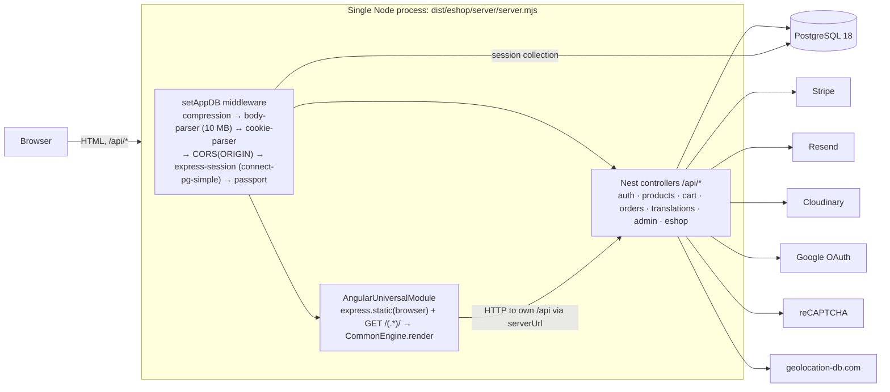
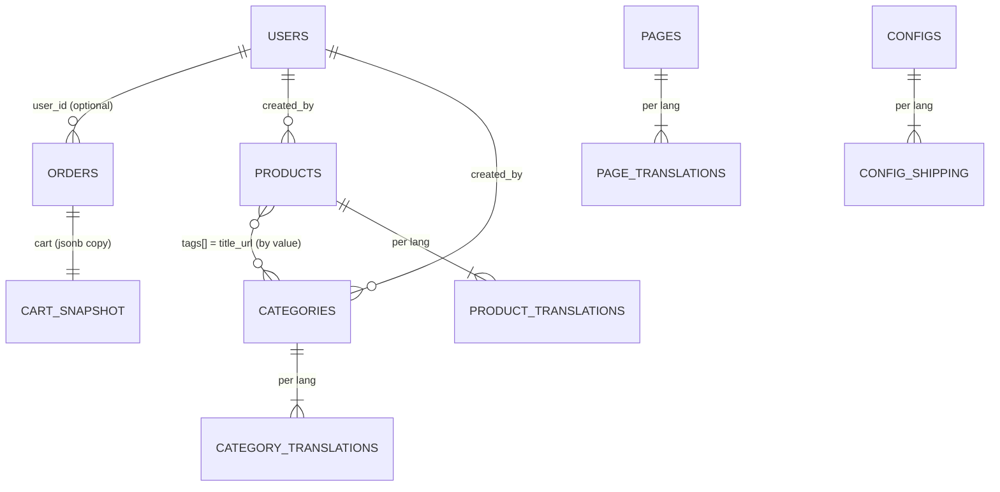

# Architecture

This document describes the state of the `master` branch as of 2026-10-15 (Angular 22.2,
NestJS 12, PostgreSQL 18 via Drizzle ORM). It is meant for onboarding. Database design, seeding and
the schema-change runbook are in [database.md](database.md).

Known problems are listed in [audit.md](audit.md); this document describes what _is_,
not what should be.

## 1. Runtime topology

- Production entry:
  1. `angular.json` → `ssr.entry: server-ssr.ts`, which imports
     `server/src/main-ssr.ts`. The whole Nest app is bundled into the Angular server bundle.
  2. `main-ssr.ts` creates `AppSSRModule` (= `AppModule` + `AngularUniversalModule`) and
     listens on `PORT`.
  3. `AngularUniversalModule` registers static file serving and a catch-all GET route
     after the API routes. Unknown `/api/*` GETs therefore fall through to SSR.
- During SSR, Angular calls the API over HTTP. It uses the `serverUrl` provider, built
  from the incoming request's protocol and `Host` header.
- **Development:** `server/src/main.ts` (API only, `:4000`) plus `ng serve` (`:3000`).
- **Docker** (`Dockerfile`, image about 175 MB):
  1. **build** (`node:24.21-alpine3.24`): `npm ci`, then `npm run build:ssr`. It also writes a
     one-dependency `package.json` with the lockfile's `pg` version.
  2. **runtime-deps:** installs only that (`pg` and its dependencies). The bundle keeps
     `pg` external (`angular.json` `externalDependencies`); everything else is inlined
     into `dist/`.
  3. **runtime:** `dist/` plus those `node_modules`. It runs as user `node`, with `tini` as PID 1
     (so `docker stop` is immediate), and `CMD node dist/eshop/server/server.mjs`. No `.env` is
     baked in; configuration comes from `--env-file` / `-e`.

**Shared types:** [`shared/types/index.d.ts`](../shared/types/index.d.ts) (`@eshop/shared`) describes the
API payloads and stored documents (products with per-language sub-documents, carts, orders, users,
pages, themes, configs). The client's `shared/models.ts` and the server's `models/` interfaces build
on it.

## 2. Backend (NestJS)

### Modules

| Module                                    | Responsibility                                                                                | Tables used                                 | Notes                                                   |
| ----------------------------------------- | --------------------------------------------------------------------------------------------- | ------------------------------------------- | ------------------------------------------------------- |
| `AppModule`                               | Root. `ConfigModule.forRoot({isGlobal})`, global `DatabaseModule` (Drizzle on `DATABASE_URL`) | –                                           | `ServeStaticModule` is commented out                    |
| `AuthModule`                              | Signup/signin, JWT, Google OAuth, `RolesGuard`                                                | `User`                                      | Exports `JwtStrategy` and `PassportModule`              |
| `ProductsModule`                          | Products and categories (public + admin CRUD)                                                 | `Product`, `Category`                       |                                                         |
| `CartModule`                              | Session cart add/remove/get                                                                   | (Product via `ProductsModule`)              |                                                         |
| `OrdersModule`                            | Cash-on-delivery orders, admin order management, order emails                                 | `Order`, `Translation`                      |                                                         |
| `TranslationsModule`                      | UI translation dictionaries                                                                   | `Translation`                               | Controller queries the database directly (no service)   |
| `AdminModule`                             | Image library and Cloudinary upload                                                           | (Product via `ProductsModule`)              | Class-level JWT + admin guards                          |
| `EshopModule`                             | Shop config, themes, CMS pages, contact form                                                  | `Page`, `Theme`, `Config`, `Translation`    |                                                         |
| `PaymentsModule`                          | Stripe card payments: intents, completion, webhooks, refunds                                  | `orders`, `stripe_events`                   | Stripe client injected as `STRIPE` (null without a key) |
| `AiModule`                                | AI product drafts (Gemini / Claude behind `LlmProvider`), see [ai.md](ai.md)                  | `ai_usage`, `categories`, `products` (read) | Off without an API key (endpoint 404)                   |
| `AppSSRModule` / `AngularUniversalModule` | SSR rendering + static files                                                                  | –                                           | Production only                                         |

### Request pipeline

Startup: `db/startup.ts` applies pending migrations (advisory lock) before the app is created.

Middleware: `setAppDB.ts`: trust proxy (`TRUST_PROXY`), helmet security headers (CSP report-only),
compression, body parsing, cookies, CORS, session (`httpOnly`, `SameSite=Lax`, `Secure` over HTTPS),
passport. There is no global prefix and no global `ValidationPipe`. Sign-in, sign-up, contact and
order endpoints are rate limited per IP (`@RateLimited()`, `@nestjs/throttler`, in memory).

**Auth**

- `Authorization: Bearer <jwt>` is checked by `JwtStrategy`.
- The payload is `{ email }`. The strategy loads the user by email on every request.
- `RolesGuard` requires `'admin'` in `user.roles`.

**Language**

- Most endpoints read the `lang` request header (`en` | `sk` | `cs`).
- Products and pages project or sort on `<lang>.*` fields.

**Session** (express-session + connect-pg-simple, table `session`, 30-day cookie) holds:

- `session.cart = { items: [{ id, qty, item: <full Product document snapshot> }] }`;
- `session.images`: the admin's image library.

### Endpoints

Guard legend:

- `–` public;
- `JWT` logged in;
- `ADMIN` JWT + `RolesGuard`.

"Pipe" means a `ValidationPipe` actually runs on that endpoint.

| Method | Path                                | Guard            | Pipe                 | Purpose                                                                                                                 |
| ------ | ----------------------------------- | ---------------- | -------------------- | ----------------------------------------------------------------------------------------------------------------------- |
| GET    | `/api/auth`                         | JWT              | –                    | Current user `{id, email, roles}`                                                                                       |
| POST   | `/api/auth/signup`                  | –                | yes (no whitelist)   | Create user (email, password)                                                                                           |
| POST   | `/api/auth/signin`                  | –                | yes                  | Returns `{accessToken, id, roles, email}`                                                                               |
| GET    | `/api/auth/google`                  | google           | –                    | Start OAuth                                                                                                             |
| GET    | `/api/auth/google/callback`         | google           | –                    | Redirect to `${ORIGIN}/jwtToken/<jwt>`                                                                                  |
| GET    | `/api/products`                     | –                | yes                  | Paginated list. Query `page, sort, category?, search?, maxPrice?`; header `lang`                                        |
| GET    | `/api/products/categories`          | –                | –                    | Visible categories for `lang`                                                                                           |
| GET    | `/api/products/search?query=`       | –                | –                    | Title search (regex)                                                                                                    |
| GET    | `/api/products/all`                 | ADMIN            | –                    | All products                                                                                                            |
| GET    | `/api/products/:name`               | –                | –                    | Product by `titleUrl` (`?lang=` → localized shape)                                                                      |
| DELETE | `/api/products/:name`               | ADMIN            | –                    | Delete product                                                                                                          |
| POST   | `/api/products/add`                 | ADMIN            | –                    | Create product (creates categories from tags)                                                                           |
| PATCH  | `/api/products/edit`                | ADMIN            | –                    | Upsert product by `titleUrl`                                                                                            |
| GET    | `/api/products/categories/all`      | ADMIN            | –                    | All categories                                                                                                          |
| PATCH  | `/api/products/categories/edit`     | ADMIN            | –                    | Upsert category                                                                                                         |
| DELETE | `/api/products/categories/:name`    | ADMIN            | –                    | Delete category and pull it from product tags                                                                           |
| GET    | `/api/cart`                         | –                | –                    | Localized cart with totals                                                                                              |
| GET    | `/api/cart/add?id=`                 | –                | yes                  | Add product to session cart                                                                                             |
| GET    | `/api/cart/remove?id=`              | –                | yes                  | Remove one unit                                                                                                         |
| GET    | `/api/orders`                       | JWT              | –                    | Current user's orders                                                                                                   |
| POST   | `/api/orders/add`                   | –                | –                    | Cash-on-delivery order from session cart + emails                                                                       |
| POST   | `/api/orders/stripe`                | –                | –                    | **Removed** (410 Gone); card payments use `/api/payments`                                                               |
| POST   | `/api/payments/intent`              | (JWT optional)   | yes (whitelist, 422) | Create/update the card order (PENDING_PAYMENT) and its PaymentIntent from the session cart ([payments.md](payments.md)) |
| POST   | `/api/payments/complete`            | session          | yes                  | Order payment state after Stripe.js confirmed; marks PAID once, empties the cart                                        |
| POST   | `/api/payments/webhook`             | Stripe signature | –                    | Stripe webhooks (raw body)                                                                                              |
| POST   | `/api/admin/orders/:orderId/refund` | ADMIN            | yes                  | Full or partial refund                                                                                                  |
| GET    | `/api/orders/all`                   | ADMIN            | –                    | All orders                                                                                                              |
| GET    | `/api/orders/:id`                   | ADMIN            | –                    | Order by `orderId`                                                                                                      |
| PATCH  | `/api/orders`                       | ADMIN            | –                    | Update order (e.g. status)                                                                                              |
| GET    | `/api/translations?lang=`           | –                | –                    | Translation dictionary. Without `lang`, guessed by geolocation.                                                         |
| GET    | `/api/translations/all`             | ADMIN            | –                    | All dictionaries                                                                                                        |
| PATCH  | `/api/translations/all`             | ADMIN            | –                    | Bulk upsert dictionaries                                                                                                |
| PATCH  | `/api/translations?lang=`           | ADMIN            | –                    | Update one dictionary                                                                                                   |
| GET    | `/api/admin/images`                 | ADMIN            | –                    | Session image library                                                                                                   |
| POST   | `/api/admin/images/add`             | ADMIN            | –                    | Add image URL to product or library                                                                                     |
| POST   | `/api/admin/images/upload`          | ADMIN            | –                    | Multipart upload → Cloudinary                                                                                           |
| POST   | `/api/admin/images/remove`          | ADMIN            | –                    | Remove image from product or library                                                                                    |
| GET    | `/api/admin/ai/status`              | ADMIN            | –                    | `{ enabled, provider?, model? }`                                                                                        |
| GET    | `/api/admin/overview?days=`         | ADMIN            | –                    | Overview figures for 1, 7 or 30 days (sales per currency, revenue per day, top products, attention, AI usage)           |
| POST   | `/api/admin/products/ai-draft`      | ADMIN            | yes (whitelist, 422) | AI product draft from Cloudinary image URLs and text; never saved ([ai.md](ai.md))                                      |
| GET    | `/api/eshop/config`                 | –                | –                    | Base64 JSON of the env vars starting with `FE_` + active theme styles. Does not touch the session.                      |
| POST   | `/api/eshop/contact`                | –                | –                    | Contact form (reCAPTCHA) → emails                                                                                       |
| GET    | `/api/eshop/page/all?titles=`       | –                | –                    | CMS pages                                                                                                               |
| POST   | `/api/eshop/page`                   | ADMIN            | –                    | Upsert page                                                                                                             |
| GET    | `/api/eshop/page/:titleUrl`         | –                | –                    | Page by slug (header `lang`)                                                                                            |
| DELETE | `/api/eshop/page/:titleUrl`         | ADMIN            | –                    | Delete page                                                                                                             |
| GET    | `/api/eshop/theme/all`              | –                | –                    | All themes                                                                                                              |
| POST   | `/api/eshop/theme`                  | ADMIN            | –                    | Upsert theme                                                                                                            |
| DELETE | `/api/eshop/theme/:titleUrl`        | ADMIN            | –                    | Delete theme                                                                                                            |
| GET    | `/api/eshop/config/all`             | –                | –                    | All shop configs                                                                                                        |
| POST   | `/api/eshop/config`                 | ADMIN            | –                    | Upsert config                                                                                                           |
| DELETE | `/api/eshop/config/:titleUrl`       | ADMIN            | –                    | Delete config                                                                                                           |

## 3. Frontend (Angular)

**Bootstrap**

- `client/src/main.ts` bootstraps with `appConfig`: zoneless change detection, router,
  `HttpClient` with fetch, and client hydration with HTTP transfer cache.
- Two app initializers run first:
  1. load translations (`TranslateService.use`);
  2. load the runtime config (`EnvConfigurationService.load` → `GET /api/eshop/config`).
- `app.config.server.ts` adds `provideServerRendering()`.

**Routing** (`app.routes.ts`): routes are generated for each language prefix.

| Path                                                                                                       | Loads                                     | Guard                                                        |
| ---------------------------------------------------------------------------------------------------------- | ----------------------------------------- | ------------------------------------------------------------ |
| `/`                                                                                                        | `HomeComponent`                           | –                                                            |
| `/404`                                                                                                     | `NotFoundComponent`                       | –                                                            |
| `/:lang/product/{all, category/:category, :id}`                                                            | `modules/product/routes.ts` (lazy)        | –                                                            |
| `/:lang/cart` and `/:lang/cart/summary`                                                                    | `modules/cart/routes.ts` (lazy, checkout) | –                                                            |
| `/:lang/orders` and `/:lang/orders/:id`                                                                    | `modules/order/routes.ts` (lazy)          | `AuthGuard`                                                  |
| `/:lang/dashboard`, `…/products/new`, `…/products/:titleUrl`, `…/orders`, `…/orders/:id`, `…/translations` | `modules/dashboard/routes.ts` (lazy)      | `AdminGuard` (+ unsaved-changes guard on the product editor) |
| `/:lang/eshop/{contact, :titleUrl}`                                                                        | standalone eshop components               | –                                                            |
| `/:lang/authorize/{signin, signup}`                                                                        | standalone auth components                | –                                                            |
| `/jwtToken/:accessToken`                                                                                   | Google OAuth landing                      | –                                                            |
| `**`                                                                                                       | redirects to `/404`                       | –                                                            |

The admin sections (products, categories, pages, theme, config, translations) are tabs inside the
dashboard component. The Products tab is a searchable table (`admin-products/`); creating or editing a
product opens the product editor route (`product-editor/`: photos, basics, per-language tabs, AI
assistant), which saves nothing until the admin presses Save.

**State**

- A custom signal store with no NgRx:
  - `store/signal.store.selectors.ts` holds the signal slices `userState`, `eshopState`,
    `productState` and `dashboardState`, plus `computed` selectors;
  - `store/signal.store.ts` holds the "actions". Each action calls `ApiService`,
    subscribes, and updates the signals.
- Components usually consume the store through `toObservable(...)` and `| async`.

**HTTP**

- `services/api.service.ts` builds every request. It sends `Authorization: Bearer <token>`
  (token from `localStorage`) and the `lang` header, with `withCredentials: true` so the
  session cookie is included.
- Base URL:
  - dev: `http://localhost:4000`;
  - production SSR: `serverUrl`;
  - production browser: `window.location.origin`.

**i18n**

- Runtime dictionaries come from `GET /api/translations` and are rendered with the
  `translate` pipe (`{{ 'Key' | translate | async }}`).
- The active language is stored in the `eshop_lang` cookie.
- Prices and currency per language: `en`/`sk` → EUR, `cs` → CZK (`shared/constants.ts`).

**Theming**

- The active `Theme.styles` arrive base64-encoded from `/api/eshop/config`.
- `EnvConfigurationService` + `ThemeService` apply them as CSS custom properties, in the
  browser only.
- The base look comes from the Material M2 theme (`client/src/styles`).

## 4. Main data flows

**Browse**

1. `GET /api/products?page&sort&category&maxPrice` with the `lang` header.
2. `paginate` (`server/src/shared/utils/paginate.ts`) runs a sorted, skipped and limited
   find (12 per page), plus a count and the min/max `salePrice`.
3. The response is `{ all, pagination, maxPrice, minPrice }`.

**Cart**

- `GET /api/cart/add?id=` loads the product and pushes a full snapshot into
  `session.cart` (`server/src/cart/utils/cart.ts`).
- `prepareCart(cart, lang, config)` (`server/src/shared/utils/prepareUtils.ts`), with the active
  shop config read by `activeShopConfig()` (`server/src/db/shop-config.ts`) each time a cart is priced
  builds the localized cart:
  - it drops items that are invisible or have no price;
  - `totalPrice = Σ salePrice × qty`;
  - shipping is `extended` if any item has `shipping: 'extended'`, otherwise `basic`;
  - shipping cost comes from `config[lang].shippingCost[type]`, falling back to
    the hardcoded defaults in `server/src/shared/constans.ts`;
  - shipping is free when the total ≥ `limit`;
  - the returned `totalPrice` **includes** shipping.

**Checkout**

- The client runs a 3-step Material stepper: address, then payment method (card or cash
  on delivery), then summary.
- **Cash on delivery:** `POST /api/orders/add`
  1. builds an `Order` from the session cart (`status: NEW`, `type: PAYMENT_ON_DELIVERY`);
  2. emails an order confirmation to the customer and a new-order email to every `ADMIN_EMAILS`
     address via Resend (one batch request; templates in `server/src/shared/utils/email/`,
     preview with `npm run email:preview`).
- **Card** (Stripe Payment Element, deferred intent; details in [payments.md](payments.md)):
  1. The Payment Element shows the cart amount; on Pay, `elements.submit()` validates it.
  2. `POST /api/payments/intent` creates a `PENDING_PAYMENT` order and a PaymentIntent from the
     session cart (or reuses the session's pending ones on a retry).
  3. `stripe.confirmPayment` confirms in the browser (3-D Secure; redirects only when needed).
  4. The `payment_intent.succeeded` webhook or `POST /api/payments/complete` marks the order `PAID`
     exactly once and sends the emails; `complete` empties the session cart.
  5. Admins refund from the order detail (`POST /api/admin/orders/:orderId/refund`).

**Auth**

- Email/password: `POST /api/auth/signin` returns `{accessToken, …}`. The token is stored
  in `localStorage` and sent as a Bearer header.
- Google:
  1. `/api/auth/google`
  2. Google
  3. `/api/auth/google/callback`, which finds or creates the user by email and redirects
     to `/jwtToken/<jwt>`.
  4. The client stores the token there.
- Admin: users with `'admin'` in `roles`. There is no UI to grant it; it is set in the
  database.

**Admin**

- Products, categories, pages, themes, configs and translations are created and updated
  through upsert endpoints keyed by `titleUrl` (or `lang`).
- Images are uploaded via multer memory storage → Cloudinary `upload_stream`. The URL is
  stored in `Product.images` or `session.images`.
- Rich text (product descriptions, pages) is edited with TinyMCE (`FE_TINYMCE_API_KEY`).

## 5. Data model

PostgreSQL 18. The source of truth is the Drizzle schema in
[server/src/db/schema.ts](../server/src/db/schema.ts); the SQL is generated into
[server/db/migrations/](../server/db/migrations/) (`npm run db:generate`). The design decisions are
recorded in [database.md](database.md).

Common traits:

- **Keys:** `uuid` primary keys default to `uuidv7()`. The API exposes them as `_id`.
- **Slugs as natural keys:** `title_url` is unique on products, categories, pages, themes and configs,
  and the API addresses them by it (`titleUrl`). Orders are addressed by `order_number` (API
  `orderId`), translations by `lang`.
- **i18n:** per-language rows in `*_translations` tables with key `(parent_id, lang)`; `lang` is the
  `lang_code` enum (`en`, `sk`, `cs`, matching `languages` in `server/src/shared/constans.ts`).
- **API shapes:** [server/src/db/mappers.ts](../server/src/db/mappers.ts) turns rows into the
  documents the API has always returned: per-language sub-objects `en` / `sk` / `cs`, `mainImage`,
  `dateAdded` (= `created_at`), `_user`, `outcome`. A product always has all three language objects
  (`{ descriptionFull: [] }` when a language has no row).
- **Money:** `numeric(12,2)` in major units, read as JS numbers.
- **Timestamps:** `created_at` (default `now()`), `updated_at` (set by Drizzle on update).

### users

| Column          | Type         | Notes                                                                     |
| --------------- | ------------ | ------------------------------------------------------------------------- |
| `email`         | text         | Unique on `lower(email)`; login and JWT lookups are case-insensitive (D5) |
| `password_hash` | text, null   | bcrypt (salt embedded); null for Google-only accounts                     |
| `name`          | text, null   |                                                                           |
| `google_id`     | text, unique | Set for Google sign-ups                                                   |
| `roles`         | text[]       | `'admin'` grants admin                                                    |

### products + product_translations

| Column (`products`)                 | Type         | Notes                                             |
| ----------------------------------- | ------------ | ------------------------------------------------- |
| `title_url`                         | text, unique | Slug                                              |
| `main_image_url`, `main_image_name` | text, null   | API `mainImage { url, name }` (Cloudinary)        |
| `images`                            | text[]       | Image URLs                                        |
| `tags`                              | text[]       | Category `title_url`s, by value (D6); GIN-indexed |
| `created_by`                        | uuid → users | API `_user`; set null when the user is deleted    |
| `created_at`                        | timestamptz  | API `dateAdded`; sort key for "newest" / "oldest" |

| Column (`product_translations`) | Type                | Notes                                                |
| ------------------------------- | ------------------- | ---------------------------------------------------- |
| `product_id`, `lang`            | key                 | Cascade delete with the product                      |
| `title`, `description`          | text                |                                                      |
| `description_full`              | text[]              | HTML fragments (TinyMCE)                             |
| `regular_price`                 | numeric(12,2), null | Not used in pricing                                  |
| `sale_price`                    | numeric(12,2), null | **The** price                                        |
| `on_sale`                       | boolean             | Display only                                         |
| `stock`                         | **text**, null      | Display only; never checked or decremented (D7)      |
| `visibility`                    | boolean             | Hidden products are excluded from lists and the cart |
| `shipping`                      | text                | `'basic'` / `'extended'`                             |
| `seo_title`                     | text                | Product page `<title>`; empty → `title`              |
| `meta_description`              | text                | Product page meta description; empty → `description` |

Index `product_translations_listing (lang, visibility, sale_price)` serves the shop listing.

### categories + category_translations

| Column (`categories`)                                   | Type         | Notes                                                                              |
| ------------------------------------------------------- | ------------ | ---------------------------------------------------------------------------------- |
| `title_url`                                             | text, unique | Matches entries of `products.tags`                                                 |
| `main_image_url`, `main_image_name`, `main_image_cover` |              | API `mainImage { url, name, type }`; `type: true` renders with `object-fit: cover` |
| `sub_categories`                                        | text[]       |                                                                                    |
| `created_by`                                            | uuid → users | API `_user`                                                                        |

`category_translations (category_id, lang)`: `title`, `description`, `position` (menu order),
`visibility`, `menu_hidden`.

Categories are created automatically from product tags when products are added or edited, and
removed from products' `tags` (one `array_remove` update) when a category is deleted.

### orders

| Column            | Type                | Notes                                                                                    |
| ----------------- | ------------------- | ---------------------------------------------------------------------------------------- |
| `order_number`    | text, unique        | API `orderId`: `'order' + Date.now() + 't' + random(1..1000)`                            |
| `user_id`         | uuid → users, null  | API `_user`; taken from the request body (`userId`)                                      |
| `customer_email`  | text                |                                                                                          |
| `status`          | `order_status` enum | `NEW`, `PAID`, `SHIPPING`, `COMPLETED`, `CANCELED`                                       |
| `type`            | text, null          | `PAYMENT_ON_DELIVERY` / `WITH_PAYMENT`                                                   |
| `currency`        | char(3)             | Derived on the server from the language (`EUR` / `CZK`)                                  |
| `amount`          | numeric(12,2)       | Total incl. shipping                                                                     |
| `amount_refunded` | numeric(12,2), null | Never written by the code                                                                |
| `notes`           | text, null          | Customer note                                                                            |
| `card_id`         | text, null          | Stripe charge id (card orders)                                                           |
| `seller_message`  | text, null          | API `outcome.seller_message`; mirrors `type`                                             |
| `cart`            | jsonb               | **Snapshot** of the localized cart: items with product data, `totalPrice`, `totalQty`, … |
| `addresses`       | jsonb               | Address objects from the checkout form; `[0]` is used in emails                          |
| `created_at`      | timestamptz         | API `dateAdded`                                                                          |

### translations, pages, themes, configs

- **`translations`** `(lang PK, keys jsonb)`: flat dictionary `{ "Key": "Text" }` per language (UI
  strings and email texts).
- **`pages`** `(title_url unique)` + **`page_translations`** `(page_id, lang, title, content_html)`;
  API `en/sk/cs: { title, contentHTML }`.
- **`themes`** `(title_url unique, active, styles jsonb)`: `styles` holds the theme settings typed as
  `ThemeStyles` (`shared/types`): brand color, shop name, logo, home hero and promo banner, promo texts
  per language. The server accepts only those keys with valid values (`server/src/eshop/theme-styles.ts`,
  400 otherwise) and merges a save into the stored settings; the client applies them through
  `ThemeService.applyStyles`. At most one is active (partial unique index; saving an active one
  deactivates the others, D8).
- **`configs`** `(title_url unique, active)` + **`config_shipping`** `(config_id, lang, basic_cost,
basic_limit, extended_cost, extended_limit)`; API `en/sk/cs: { shippingCost: { basic: {cost, limit},
extended: {cost, limit} } }`. At most one is active (D8); carts are priced with it on every request (`activeShopConfig()`).

### ai_usage

One row per AI provider call (successful or not): `user_id` → users (set null), `provider`,
`model`, `image_count`, `input_tokens`, `output_tokens`, `cost_usd numeric(12,6)` (estimate),
`duration_ms`, `status` (`ai_usage_status`: `ok`, `invalid_output`, `error`, `timeout`),
`error_code`, `created_at`. The AI limits are counted from it; queries in [ai.md](ai.md).

### session

connect-pg-simple's table: `sid` (PK), `sess` (json: `cookie`, `cart?`, `config?`, `images?`,
`passport?`), `expire` (indexed; expired rows are pruned by the store).

### Relations

## 6. External services

| Service                          | Used for                                                    | Integration                                                                                                                                                                                        | Config                                                                   |
| -------------------------------- | ----------------------------------------------------------- | -------------------------------------------------------------------------------------------------------------------------------------------------------------------------------------------------- | ------------------------------------------------------------------------ |
| Stripe                           | Card payments                                               | `stripe` SDK 23, API `2026-09-30.endive`, PaymentIntents + Payment Element, signed webhooks, refunds ([payments.md](payments.md))                                                                  | `STRIPE_SECRETKEY`, `STRIPE_WEBHOOK_SECRET`, `FE_STRIPE_PUBLISHABLE_KEY` |
| Resend                           | Order and contact emails to the customer and `ADMIN_EMAILS` | `fetch` to the Resend API (`shared/utils/email/resend-transport.ts`): one batch request per event, idempotency key per order, one retry on 429; HTML templates in `server/src/shared/utils/email/` | `RESEND_API_KEY`, `EMAIL_FROM`                                           |
| Cloudinary                       | Product and site images                                     | `cloudinary` v2 `upload_stream` from a multer memory buffer                                                                                                                                        | `CLOUDINARY_*`                                                           |
| Google OAuth 2.0                 | Social login                                                | `passport-google-oauth20`, scopes `profile` and `email`                                                                                                                                            | `GOOGLE_CLIENT_*`, `SERVER_URL`, `ORIGIN`                                |
| Google reCAPTCHA v3              | Contact-form spam protection                                | Client: vendored ng-recaptcha service. Server: `siteverify`.                                                                                                                                       | `FE_RECAPTCHA_CLIENT_KEY`, `RECAPTCHA_SERVER_KEY`                        |
| geolocation-db.com               | Default language when none is chosen                        | Called from the server                                                                                                                                                                             | `GEO_LOCATION_API_KEY`                                                   |
| TinyMCE Cloud                    | Rich-text editor in admin                                   | `@tinymce/tinymce-angular`                                                                                                                                                                         | `FE_TINYMCE_API_KEY`                                                     |
| Google Analytics                 | Analytics                                                   | `services/analytics.service.ts` (gtag)                                                                                                                                                             | `FE_ANALYTICS_TOKEN`                                                     |
| PostgreSQL 18                    | Data and sessions                                           | Drizzle ORM + `pg` + connect-pg-simple                                                                                                                                                             | `DATABASE_URL`                                                           |
| Google Gemini / Anthropic Claude | AI product drafts (optional)                                | `fetch` clients in `server/src/ai/providers/`, structured output ([ADR 0001](adr/0001-ai-provider-abstraction.md))                                                                                 | `AI_PROVIDER`, `GEMINI_API_KEY`, `ANTHROPIC_API_KEY`                     |
