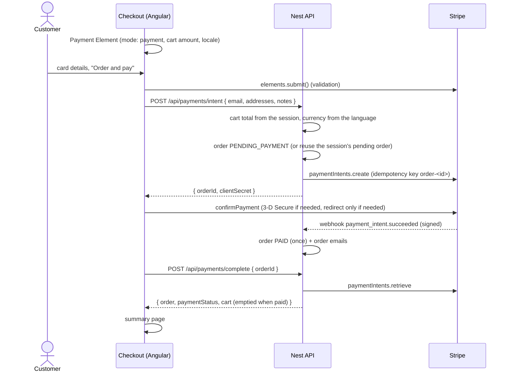

# Card payments (Stripe Payment Element)

Card orders use the Stripe **Payment Element** with the **PaymentIntents API** (deferred-intent
flow). Cash on delivery is unchanged. Apple Pay is turned off; Google Pay and the payment methods
enabled in the Stripe dashboard are offered automatically.

- Server: [server/src/payments/](../server/src/payments/) · Client: [client/src/app/modules/cart/card/](../client/src/app/modules/cart/card/)
- SDK `stripe@23.0.0`, API version **`2026-09-30.endive`** (pinned in `stripe.client.ts`; change both together)

## 1. Flow



- **Prices are always computed on the server** from the session cart (`prepareCart`); the client
  never sends an amount, a currency (derived from the language: en/sk → EUR, cs → CZK) or a user id
  (taken from the JWT when logged in).
- **Order states:** `PENDING_PAYMENT` → `PAID`; `PAYMENT_FAILED` after a declined attempt (the
  customer can retry: the same order and PaymentIntent are reused, with the new amount, address and
  email); `REFUNDED` once fully refunded; `CANCELED` if Stripe cancels the intent.
- **Paid exactly once:** both the webhook and `complete` call one conditional update
  (`… WHERE status IN ('PENDING_PAYMENT','PAYMENT_FAILED')`); only the call that changes the row sends
  the emails. Either can come first; payments still complete if webhooks are delayed.
- **Redirects:** for methods that need one (3-D Secure on its own page, bank apps) Stripe returns to
  `/:lang/cart/summary?order=<orderId>`, which calls `complete`.
- The old token flow (`POST /api/orders/stripe`, Charges API, capture before save, audit BUG-02) is
  removed; the endpoint answers **410 Gone** so cached old clients get a clear message.

## 2. API

| Endpoint                                 | Who              | Notes                                                                                                                                                                 |
| ---------------------------------------- | ---------------- | --------------------------------------------------------------------------------------------------------------------------------------------------------------------- |
| `POST /api/payments/intent`              | anyone (session) | Body `PaymentIntentRequest`. 200 `{ orderId, clientSecret, amount, currency }`; 422 invalid body or empty cart; 502 Stripe refused; 503 not configured. Rate limited. |
| `POST /api/payments/complete`            | the same session | Body `{ orderId }`. 200 `{ order, paymentStatus, cart }`; 404 for other sessions (order numbers are not secret).                                                      |
| `POST /api/payments/webhook`             | Stripe           | Signature-verified on the raw body. 400 bad signature; 503 without `STRIPE_WEBHOOK_SECRET`. Duplicates are acknowledged and skipped.                                  |
| `POST /api/admin/orders/:orderId/refund` | admin            | Body `{ amount? }` (major units; empty = the rest). 409 not a paid card order / already refunded; 422 more than is left.                                              |

Types: `PaymentIntentRequest`, `PaymentIntentResponse`, `PaymentCompleteResponse`, `RefundRequest`
in [shared/types/index.d.ts](../shared/types/index.d.ts).

## 3. Webhooks

Handled events (subscribe to exactly these):

| Event                           | Effect                                                                    |
| ------------------------------- | ------------------------------------------------------------------------- |
| `payment_intent.succeeded`      | order `PAID`, charge id stored, emails sent (once)                        |
| `payment_intent.payment_failed` | order `PAYMENT_FAILED` with Stripe's message in `description`             |
| `payment_intent.canceled`       | a still-unpaid order → `CANCELED`                                         |
| `charge.refunded`               | `amount_refunded` set from Stripe's total; `REFUNDED` when fully refunded |

- Verified with `stripe.webhooks.constructEvent` on the exact request bytes (`setAppDB.ts` keeps the
  raw body for `/api/payments/webhook` only) and Stripe's default 5-minute tolerance.
- Processed event ids are stored in `stripe_events`; a redelivery answers `{ received: true,
duplicate: true }`. Handlers are idempotent as well, so concurrent duplicates are harmless.
- Event order is not relied upon.

**Production setup** (Stripe Dashboard → Workbench → Webhooks → Create an event destination):
"Your account", payload **Snapshot**, the four events above, endpoint
`https://<your-domain>/api/payments/webhook`. Copy the `whsec_…` signing secret into the server
environment as `STRIPE_WEBHOOK_SECRET` (test mode and live mode have different secrets).

**Local development** with the [Stripe CLI](https://docs.stripe.com/stripe-cli):

```sh
stripe login
stripe listen --forward-to localhost:4000/api/payments/webhook \
  --events payment_intent.succeeded,payment_intent.payment_failed,payment_intent.canceled,charge.refunded
# put the printed whsec_… into .env as STRIPE_WEBHOOK_SECRET, restart npm run start:dev
```

Test cards: `4242 4242 4242 4242` (succeeds), `4000 0025 0000 3155` (3-D Secure),
`4000 0000 0000 9995` (declined); any future date and CVC.

## 4. Configuration

| Variable                    | Where               | Notes                                                                                                          |
| --------------------------- | ------------------- | -------------------------------------------------------------------------------------------------------------- |
| `STRIPE_SECRETKEY`          | server              | `sk_test_…` / `sk_live_…`; without it card payments answer 503                                                 |
| `FE_STRIPE_PUBLISHABLE_KEY` | sent to the browser | `pk_test_…` / `pk_live_…`; the Payment Element needs it                                                        |
| `STRIPE_WEBHOOK_SECRET`     | server              | `whsec_…` of the webhook endpoint; without it webhooks answer 503 (payments still complete through `complete`) |
| `STRIPE_API_BASE`           | tests only          | points the SDK at the local stub; never set in production                                                      |

The startup log warns when a key or the webhook secret is missing. The CSP (report-only) allows
`js.stripe.com`, `*.js.stripe.com`, `api.stripe.com`, `*.stripe.com`, `*.stripe.network` and
`hooks.stripe.com` frames.

## 5. Testing

No test calls Stripe. The real SDK runs against a local stub of the Stripe API
([server/test/utils/stripe-stub.ts](../server/test/utils/stripe-stub.ts): PaymentIntents, refunds,
idempotency keys, signed webhooks), shared by the API tests and the e2e server (Node runs the `.ts`
file directly). The test environment points `STRIPE_API_BASE` at a closed port, so a test that forgets
the stub fails instead of reaching Stripe.

- API: [server/test/api/payments.spec.ts](../server/test/api/payments.spec.ts) — intent (server
  amounts, minor units, idempotency, retry reuse, user from the JWT only, validation, Stripe failure),
  complete (paid once, processing, other sessions), webhooks (signature, tampering, replay window,
  duplicates, failed payments), refunds (partial, full, limits, admin only), disabled configuration.
- E2E: [e2e/tests/checkout.spec.ts](../e2e/tests/checkout.spec.ts) with a fake Stripe.js
  ([e2e/tests/helpers.ts](../e2e/tests/helpers.ts)) that renders a stand-in card field and confirms
  through the stub, which then sends the signed webhook to the app: successful payment, declined then
  retried, 3-D Secure redirect back to the summary, incomplete card; admin refund in `admin.spec.ts`.

The integration was also checked once by hand against the Stripe sandbox (create with idempotency,
update, confirm with `pm_card_visa`, partial refund, webhook signatures) with the pinned API version.

## 6. Going live

1. Switch the keys to live ones (`sk_live_…`, `pk_live_…`) in the server environment.
2. Create the live webhook endpoint (§3) and set its `STRIPE_WEBHOOK_SECRET`.
3. In the Stripe dashboard, enable the payment methods you want (cards are on by default) and keep
   Apple Pay off or leave it: the shop never offers it.
4. Deploy; migration `0002_stripe_payment_intents` runs at startup (new statuses, `payment_intent_id`,
   `stripe_events`; additive).
